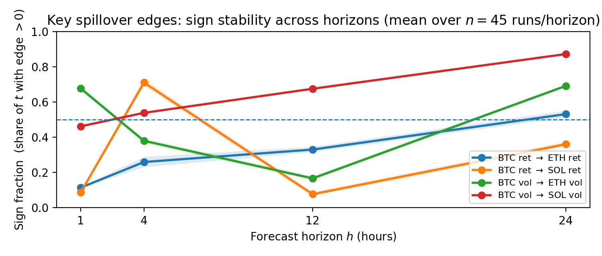

# Horizon-dependent neural GVAR for crypto spillovers

Course project for Deep Learning at ETH Zürich, autumn 2025, with Cem Özkan, Lucas Poinsignon and Athanasios Kakafikas. Full report: [paper/report.pdf](paper/report.pdf).

**Question.** Standard deep learning forecasters fit crypto returns and volatility well but say nothing about which asset moves which. Classical Granger causality is interpretable but linear and time-invariant. We wanted one model that forecasts hourly BTC, ETH and SOL jointly and also exposes a directed, lagged spillover network that can be tested against concrete market hypotheses.

**Model.** A neural generalised VAR: the prediction for horizon *h* is a sum over lags {1, 3, 6, 12} of an adjacency matrix times the lagged series, plus a linear concept head on RSI divergence and funding rate. In the gated version (NeuralGVAR) a small MLP modulates a learned base adjacency with the current state. The ablation StaticGVAR fixes the adjacency. Separate models per horizon *h* in {1, 4, 12, 24} hours, trained with a group-sparsity penalty on edges and a smoothness penalty over time. Baselines: last value, VARX-LASSO, a compact LSTM.

**Evaluation.** Three walk-forward windows (train 2021 to 2022, test 2023; train 2021 to 2023, test 2024; train 2022 to 2024, test 2025), 5 seeds, 3 sparsity levels, so 45 runs per task and horizon. Edge sign stability and medians get moving block bootstrap intervals. Five hypotheses are tested out of sample, with event conditioning against matched controls, a shifted placebo and random events.

**What we found.**

- Spillover structure varies far more across forecast horizons than across market states. StaticGVAR matches NeuralGVAR almost exactly, so state gating adds little under this feature set.
- Return contagion from BTC is weak at 1 hour and only shows up at multi-hour horizons (BTC to SOL positive in about 71% of test time at h = 4).
- Volatility spillover BTC to SOL strengthens steadily with horizon and is positive in about 87% of test time at h = 24, consistent with slow, liquidity-driven transmission.
- Funding-rate extremes reliably precede higher volatility, strongest for SOL. RSI divergence gives no robust mean-reversion signal.
- Forecast accuracy: VARX-LASSO, StaticGVAR and NeuralGVAR are tied on returns; the LSTM is slightly worse and last-value much worse. On volatility, last-value is hard to beat at h = 1 and the structured models pull ahead at longer horizons.



The practical takeaway: for Granger-style questions in crypto, think in a family of graphs indexed by horizon rather than one graph with time-varying edges.

## Repository

- `preprocessing.ipynb`: downloads hourly perpetual futures data and builds `data/processed/features_<SYMBOL>.parquet` (log returns, 24h realised volatility, RSI divergence, funding rate).
- `analysis.ipynb`: trains or reloads all models, runs the backtests, computes metrics (MSE, MAE, sign hit rate), hypothesis and event-conditioning tables, and exports everything to `paper_assets/`.
- `checkpoints/`: saved model weights per window, seed, sparsity and horizon.
- `paper_assets/`: the CSV and LaTeX tables and PNG figures used in the report.
- `paper/report.pdf`: the written report.

## Running it

```bash
pip install -r requirements.txt        # Python 3.11
# or: conda env create -f environment.yml
```

1. Run `preprocessing.ipynb` to create the processed feature files.
2. Run `analysis.ipynb` to train or reload models, evaluate, and export the assets. Set `FAST_MODE = True` at the top for a short debug run.

Stack: PyTorch, statsmodels, scikit-learn, pandas.
